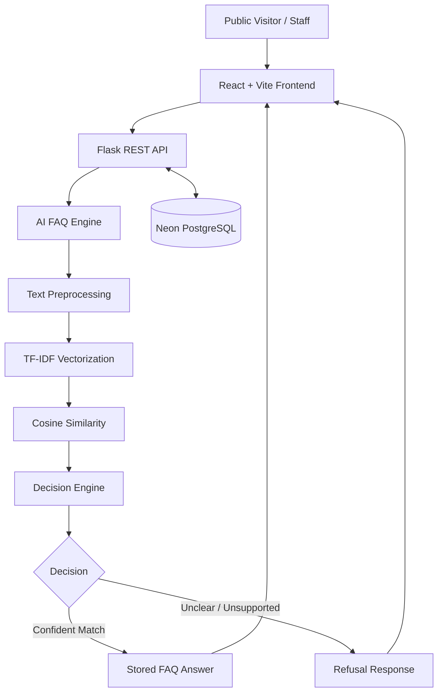

# ◈ Arc Lite — AI-Powered FAQ Assistant

**An intelligent FAQ assistant that provides relevant answers from a verified knowledge base — and refuses to guess when it doesn't know.**

<p align="center">
  <a href="https://arc-lite-umber.vercel.app/"><strong>Live Demo</strong></a>
  &nbsp; • &nbsp;
</p>

---

## 📌 Overview

Arc Lite is a full-stack AI-powered FAQ assistant designed to make information easier to access through natural-language questions.

Instead of relying on simple keyword matching or generating potentially incorrect answers, Arc Lite uses a machine-learning-based FAQ retrieval engine to identify relevant questions from a knowledge base.

Its core principle is:

> **Answer when there is sufficient confidence. Refuse when there isn't.**

The application provides two main interfaces:

- **Public Chat Interface:** Visitors can ask questions without creating an account, receive relevant FAQ answers, and provide feedback.
- **Staff Dashboard:** Authorized staff can manage FAQs, monitor conversations, review analytics, and maintain the knowledge base.

The project uses a Flask REST API, a React frontend, a TF-IDF-based retrieval engine, and PostgreSQL for persistent data storage.

## 🚀 Live Demo

| Component | Link |
|---|---|
| Public Application | https://arc-lite-umber.vercel.app/ |
| GitHub Repository | https://github.com/Priyanshu-pandey1/Arc-Lite |

**Note:** The FAQ entries currently contain demonstration/sample content. They are not an official ArchintX knowledge base.

## ✨ Key Features

### 1. Public FAQ Chatbot
- No-login public chat interface.
- Accepts natural-language questions.
- Retrieves relevant answers from the FAQ knowledge base.
- Provides a refusal response when confidence is insufficient.
- Supports thumbs-up and thumbs-down feedback.

### 2. Anonymous Visitor Chat History
- Maintains separate chat histories for different browser visitors.
- Supports conversation history management.
- Allows visitors to rename, pin, and delete conversations.
- Prevents one visitor's chat history from being displayed to another visitor.

### 3. Staff Authentication
- Dedicated staff login.
- JWT-based authentication.
- Password hashing for credential security.
- Protected staff dashboard routes.

### 4. FAQ Management
- Create and manage FAQ entries.
- Organize FAQs into categories:
  - Courses
  - Certificates
  - Jobs
  - Account
- Manage FAQ status and verification information.

### 5. Analytics Dashboard
- Monitor chatbot activity.
- Review conversation statistics.
- Analyze FAQ categories and performance.
- View user feedback and recent conversations.

### 6. Conversation Management
- Store chatbot conversations persistently.
- Allow authorized staff to review conversation records.
- Support conversation-level feedback and management.

## 🧠 AI Engine — How It Works

The central component of Arc Lite is its custom FAQ retrieval and decision-making engine.

It uses traditional Natural Language Processing (NLP) and machine-learning techniques to find the most relevant FAQ entry for a user's question.

### Retrieval Pipeline

1. **Text Preprocessing:** Processes and normalizes incoming questions.
2. **Text Vectorization:** Converts FAQ questions and user queries into numerical representations using TF-IDF.
3. **Similarity Calculation:** Uses cosine similarity to measure how closely the query matches stored FAQ questions.
4. **Phrase Matching:** Uses phrase-level matching to provide additional matching evidence.
5. **Decision Engine:** Evaluates confidence, FAQ verification status, question relevance, and other decision conditions.
6. **Response Builder:** Returns the stored FAQ answer or an appropriate refusal response.

### Technologies Used in the AI Engine

| Technique | Purpose |
|---|---|
| TF-IDF | Converts text into numerical feature vectors |
| Word N-grams (1, 2) | Captures individual words and word combinations |
| Character N-grams (2, 5) | Helps match variations in spelling and text |
| Cosine Similarity | Measures similarity between user queries and FAQ questions |
| Phrase Matching | Provides additional matching evidence |
| Decision Engine | Determines whether a response is sufficiently reliable |

### Confidence-Based Decision Making

The engine uses confidence thresholds to determine its response:

| Similarity Score | Decision |
|---|---|
| ≥ 0.50 | Answer |
| ≥ 0.25 and < 0.50 | Unclear |
| < 0.25 | Refuse |

Additional decision checks handle conditions such as inactive FAQs, unverified entries, generic questions, and out-of-scope queries.

**Important:** Arc Lite retrieves existing FAQ answers. It does not generate new answers using an LLM. Its refusal mechanism is designed to reduce unsupported or guessed responses.

## 🏗️ System Architecture



### Application Architecture

- **Frontend:** Handles the public chatbot, staff authentication, FAQ management, and analytics dashboard.
- **Backend:** Provides REST API endpoints, authentication, database operations, and application logic.
- **AI Engine:** Performs FAQ retrieval, similarity scoring, and response decisions.
- **Database:** Stores FAQs, staff information, conversations, visitor history, and feedback.

## 🛠️ Tech Stack

| Layer | Technologies |
|---|---|
| Frontend | React 19, Vite |
| Backend | Python, Flask 3 |
| API | REST API |
| AI / NLP | Scikit-learn, TF-IDF, Cosine Similarity |
| Data Processing | NumPy |
| Database | PostgreSQL |
| Database Hosting | Neon |
| Authentication | JWT, Password Hashing |
| Frontend Deployment | Vercel |
| Backend Deployment | Render |
| Version Control | Git, GitHub |

## 🗄️ Database

Arc Lite uses PostgreSQL hosted on Neon for persistent application data.

The database supports:

- FAQ knowledge-base records.
- Staff authentication.
- Conversation records.
- Anonymous visitor sessions and chat history.
- User feedback.
- Analytics-related information.

## 🧪 Testing and Quality Assurance

Testing was performed across the AI engine, backend APIs, and frontend application.

| Testing Area | Coverage |
|---|---|
| AI Engine | Matching, confidence decisions, refusal behaviour, and robustness |
| Backend APIs | FAQ operations, conversations, visitor history, analytics, and authentication |
| Regression Testing | Verification of existing functionality after changes |
| Frontend | Linting and production build |
| Browser Testing | Manual end-to-end functional verification |
| Visitor Isolation | Verification of separate chat histories across visitors |

### Testing Summary

- Approximately **230 scripted checks** across backend API and AI-engine test scripts.
- AI evaluation using dedicated test cases and mixed-question evaluations.
- Frontend lint checks using Oxlint.
- Successful production build verification.
- Manual browser testing of public and staff workflows.
- Verification of visitor-history isolation and conversation management.

**Testing note:** The scripted checks are primarily standalone Python scripts, not a unified pytest suite. Browser testing was manual rather than automated through Playwright or Cypress. A continuous integration pipeline is not currently included.

## ⚙️ Local Installation and Setup

Follow these steps to run Arc Lite locally.

### Prerequisites

Make sure you have installed:

- Python 3.10 or later
- Node.js and npm
- Git
- A PostgreSQL database

### 1. Clone the Repository

```bash
git clone https://github.com/Priyanshu-pandey1/Arc-Lite.git
cd Arc-Lite
```

### 2. Backend Setup

Navigate to the backend directory:

```bash
cd backend
```

Create and activate a virtual environment:

```powershell
python -m venv venv
.\venv\Scripts\Activate.ps1
```

Install the dependencies:

```bash
pip install -r requirements.txt
```

Create a `.env` file inside the backend directory and configure the required environment variables.

### 3. Backend Environment Variables

Configure the following variables using your own credentials:

```env
DATABASE_URL=your_postgresql_connection_string
JWT_SECRET=your_secure_secret_key
CORS_ORIGINS=http://localhost:5173
```

Start the Flask backend using the project's configured application entry point.

### 4. Frontend Setup

Open a new terminal and navigate to the frontend directory:

```bash
cd frontend
```

Install dependencies:

```bash
npm install
```

Create a `.env` file inside the frontend directory:

```env
VITE_API_BASE_URL=http://localhost:5000/api
```

Start the development server:

```bash
npm run dev
```

The frontend will be available at the local development URL displayed by Vite.

**Important:** Use your own PostgreSQL database credentials and a secure JWT secret. Never commit `.env` files, database credentials, or secret keys to GitHub. Check the detailed deployment documentation for the complete configuration.

## ☁️ Deployment

Arc Lite is deployed using the following services:

| Component | Platform |
|---|---|
| Frontend | Vercel |
| Backend | Render |
| PostgreSQL Database | Neon |

### Deployment Configuration

- The React frontend is deployed on Vercel.
- The Flask backend is hosted on Render using Gunicorn.
- Neon PostgreSQL provides persistent database storage.
- Environment variables configure database access, authentication, and frontend-backend communication.

## 📁 Project Structure

```text
Arc-Lite/
│
├── backend/
│   ├── ai_engine/
│   │   ├── decision_engine.py
│   │   ├── engine.py
│   │   ├── matcher.py
│   │   ├── preprocessing.py
│   │   ├── response_builder.py
│   │   └── vectorizer.py
│   │
│   ├── data/
│   ├── tests/
│   ├── app.py
│   └── requirements.txt
│
├── frontend/
│   ├── public/
│   ├── src/
│   │   ├── components/
│   │   ├── pages/
│   │   ├── services/
│   │   └── ...
│   ├── package.json
│   └── vite.config.js
│
│
└── README.md
```

*The structure above highlights the main project components; it is not an exhaustive listing of every file.*

## 📚 Project Documentation

Detailed technical documentation is available in the repository.

| # | Document |
|---|---|
| 01 | [Project Overview](references/project_documentation/01_Project_Overview.md) |
| 02 | [Complete File Structure](references/project_documentation/02_Complete_File_Structure.md) |
| 03 | [System Architecture](references/project_documentation/03_System_Architecture.md) |
| 04 | [Frontend Deep Dive](references/project_documentation/04_Frontend_Deep_Dive.md) |
| 05 | [Backend Deep Dive](references/project_documentation/05_Backend_Deep_Dive.md) |
| 06 | [AI Engine Deep Dive](references/project_documentation/06_AI_Engine_Deep_Dive.md) |
| 07 | [Database Documentation](references/project_documentation/07_Database_Documentation.md) |
| 08 | [API Reference](references/project_documentation/08_API_Reference.md) |
| 09 | [User Flows](references/project_documentation/09_User_Flows.md) |
| 10 | [Testing and QA](references/project_documentation/10_Testing_and_QA.md) |
| 11 | [Deployment Guide](references/project_documentation/11_Deployment_Guide.md) |
| 12 | [Interview Questions and Answers](references/project_documentation/12_Interview_Questions_and_Answers.md) |
| 13 | [Project Presentation Script](references/project_documentation/13_Project_Presentation_Script.md) |
| 14 | [Technical Glossary](references/project_documentation/14_Technical_Glossary.md) |

## 🔮 Future Improvements

Potential areas for further development include:

- Automated browser-based testing.
- Continuous integration and deployment workflows.
- Improved FAQ ranking and retrieval evaluation.
- Multilingual FAQ support.
- More advanced semantic retrieval techniques.
- Expanded analytics and reporting capabilities.

## 👨‍💻 Author

**Priyanshu Pandey**

B.Tech — Computer Science and Engineering  
Artificial Intelligence and Machine Learning

- GitHub: [@Priyanshu-pandey1](https://github.com/Priyanshu-pandey1)

---

<p align="center">
  <strong>◈ Arc Lite</strong><br/>
  Built with a simple principle: Answer confidently. Never guess.
</p>
