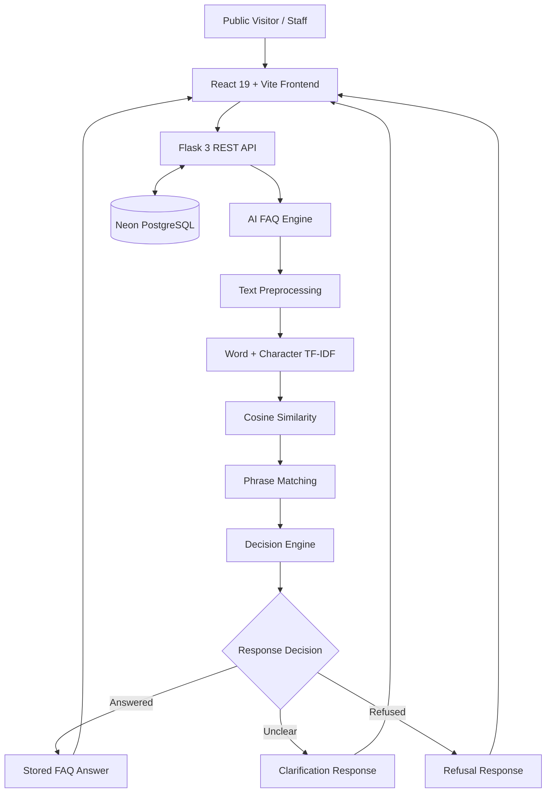

# ◈ Arc Lite | AI-Powered FAQ Assistant

**Natural-language FAQ retrieval with confidence-based decisions — answer when the system knows, refuse when it doesn't.**

<p align="center">
  <a href="https://arc-lite-umber.vercel.app/">Live Demo</a> ·
  <a href="https://github.com/Priyanshu-pandey1/Arc-Lite">GitHub Repository</a>
</p>

---

## Overview

Arc Lite is a full-stack FAQ assistant developed during my ArchintX AI Engineer internship. It helps users find information by asking questions in natural language rather than searching through static FAQ pages.

The system uses a custom NLP-based retrieval engine to match user questions against a PostgreSQL-backed FAQ knowledge base. Instead of generating answers, it retrieves existing FAQ responses and uses a decision engine to determine whether a question can be answered confidently.

Its central design principle is:

**Retrieve reliable answers. Clarify uncertainty. Never guess.**

Arc Lite consists of three main application areas:

- **Public Chatbot:** A no-login interface where visitors ask questions, receive responses, and provide feedback.
- **FAQ Management:** A staff dashboard for creating, updating, deactivating, and managing FAQ entries.
- **Analytics Dashboard:** A staff interface for monitoring conversations, response verdicts, categories, response times, and feedback.

> **Knowledge-base note:** The deployed demonstration currently uses sample FAQ entries. These are not official ArchintX knowledge-base content.

## Live Application

| Component | Link |
|---|---|
| Public Application | [Open Arc Lite](https://arc-lite-umber.vercel.app/) |
| Backend API | [Render Backend](https://arc-lite.onrender.com) |
| API Health | [Check API Status](https://arc-lite.onrender.com/api/health) |
| Source Code | [GitHub Repository](https://github.com/Priyanshu-pandey1/Arc-Lite) |

## Features

### Public Chatbot
- Ask questions using natural language.
- Receive one of three outcomes: answered, unclear, or refused.
- View similarity scores and response times.
- Provide thumbs-up or thumbs-down feedback.
- Use suggested questions from the welcome screen.
- Access chat history without creating an account.

### Anonymous Conversation History
- Generates a unique UUID for each browser visitor.
- Maintains persistent, visitor-specific conversation history.
- Supports renaming, pinning, and deleting conversations.
- Preserves conversation history across page refreshes.
- Enforces visitor ownership at the database-query level.

### Staff Authentication
- Dedicated staff login.
- JWT-based authentication using HS256.
- Eight-hour token expiry.
- Password hashing.
- Staff account activity is revalidated on protected requests.

### FAQ Management
- Create, edit, and manage FAQ entries.
- Organize FAQs into four categories:
  - Courses
  - Certificates
  - Jobs
  - Account
- Filter by category, status, and search query.
- Support active/inactive and verification-status management.
- Refresh the in-memory AI matching index after FAQ changes.

### Analytics Dashboard
- Conversation and activity statistics.
- Answered, unclear, and refused verdict breakdowns.
- Category-level analytics.
- Response-time analysis.
- User feedback monitoring.
- Recent conversation records.
- 7-day, 30-day, 90-day, and all-time reporting periods.

## AI Engine & NLP Pipeline

The core of Arc Lite is a custom FAQ retrieval engine built using Scikit-learn and traditional Natural Language Processing techniques.

It is designed for **retrieval rather than text generation**. Every answer is retrieved from an existing FAQ record; the engine does not generate new answers using an LLM.

### How the Engine Works

1. **Text Preprocessing:** Normalizes the incoming question, removes unnecessary punctuation, and handles spelling variations using domain-restricted spell correction.
2. **TF-IDF Vectorization:** Converts FAQ documents and user queries into numerical feature representations.
3. **Cosine Similarity:** Compares the query against the stored FAQ vectors.
4. **Phrase Matching:** Uses a separate keyword-phrase matching channel to provide additional matching evidence.
5. **Out-of-Scope Detection:** Identifies question terms that are absent from the FAQ vocabulary.
6. **Decision Engine:** Applies ordered rules, confidence thresholds, verification checks, and ambiguity signals.
7. **Response Builder:** Returns a stored FAQ answer or an appropriate refusal/clarification response.

### Machine Learning Techniques

| Technique | Implementation | Purpose |
|---|---|---|
| TF-IDF | Scikit-learn | Text feature representation |
| Word N-grams | (1, 2) | Captures individual words and word combinations |
| Character N-grams | `char_wb` (2, 5) | Improves tolerance to spelling and morphological variations |
| FeatureUnion | Equal word/character channel weights | Combines complementary text representations |
| Cosine Similarity | Vector similarity | Measures query-to-FAQ similarity |
| Phrase Matching | Full content-word coverage | Reduces false-positive phrase matches |
| Spell Correction | FAQ-vocabulary-restricted correction | Handles typos without freely rewriting unsupported terms |
| Decision Engine | Seven ordered decision gates | Determines whether to answer, clarify, or refuse |

### Confidence-Based Decision Making

The engine uses empirically tuned thresholds:

| Condition | Outcome |
|---|---|
| Similarity ≥ 0.50 | Eligible for an answer |
| Similarity ≥ 0.25 | May enter the unclear/refusal decision band |
| Similarity < 0.25 | Refused |

The final verdict is not determined by similarity alone. Phrase evidence, out-of-scope terms, generic questions, ambiguity signals, and FAQ status are also evaluated.

The decision engine follows seven ordered checks:

1. Inactive FAQ → Refuse.
2. Unverified FAQ in production mode → Refuse.
3. Generic question → Refuse.
4. Out-of-scope vocabulary → Refuse.
5. Ambiguous or unclear question → Clarify.
6. Full keyword-phrase match with sufficient document support → Answer.
7. Remaining cases → Apply confidence thresholds and refusal rules.

**Implementation note:** The current Flask application initializes the assistant with `allow_unverified=True` for demonstration data. The engine also supports production-mode verification checks.

### Why Retrieval Instead of an LLM?

Arc Lite prioritizes controlled answers over unrestricted generation.

- Answers come directly from stored FAQ records.
- Unsupported questions can be refused.
- Staff can update the knowledge base without retraining a generative model.
- The matching pipeline is deterministic and runs inside the Flask backend.

The trade-off is that lexical retrieval can reject some valid paraphrases that share little vocabulary with the stored FAQs. This is an area for future improvement.

## System Architecture

Arc Lite follows a three-tier architecture.



### Application Layers

| Layer | Responsibility |
|---|---|
| Frontend | Chat interface, authentication, FAQ management, and analytics |
| Backend | REST endpoints, validation, authentication, and database operations |
| AI Engine | Preprocessing, vectorization, matching, and response decisions |
| Database | Persistent storage of FAQs, staff, and conversations |

The AI engine runs in-process inside Flask. FAQ vectors are fitted at startup and refreshed after FAQ mutations.

## Technology Stack

| Category | Technologies |
|---|---|
| Frontend | React 19, Vite |
| Routing | React Router 7 |
| Styling | Tailwind CSS 3 |
| HTTP Client | Axios |
| Backend | Python 3.12, Flask 3 |
| API | REST |
| AI / NLP | Scikit-learn, TF-IDF, Cosine Similarity |
| Text Processing | NumPy, PySpellChecker |
| Database | PostgreSQL |
| Database Hosting | Neon |
| Database Driver | Psycopg 3, Psycopg Pool |
| Authentication | PyJWT, Werkzeug Password Hashing |
| Production Server | Gunicorn |
| Frontend Hosting | Vercel |
| Backend Hosting | Render |
| Version Control | Git, GitHub |

## Database Design

Arc Lite uses PostgreSQL hosted on Neon.

The application uses three primary database tables:

| Table | Purpose |
|---|---|
| `faq_entries` | Stores FAQ questions, answers, categories, keywords, and status information |
| `staff` | Stores staff accounts and password hashes |
| `conversations` | Stores visitor questions, responses, verdicts, feedback, and conversation metadata |

### Database Engineering

- Parameterized SQL queries.
- Foreign-key relationship between conversations and FAQ entries.
- Soft deletion for FAQ and conversation records.
- Visitor ID indexing for efficient history retrieval.
- Connection pooling using Psycopg Pool.
- Explicit transaction handling.
- Idempotent database migration scripts.

Connection pooling was introduced after performance profiling identified database connection setup as a major source of request latency. The pool maintains 1–4 reusable connections and checks connections when they are retrieved.

## Security & Access Control

Security is implemented at both the application and database-query levels.

- Staff authentication uses signed JWTs with an eight-hour expiry.
- Passwords are stored as hashes rather than plaintext.
- Staff activity is checked against the database on protected requests.
- Visitor IDs are UUID-validated on the backend.
- Visitor conversation queries enforce ownership using `visitor_id` filters.
- SQL queries use parameterized inputs.
- CORS is configured through an explicit origin allowlist.
- Database credentials and JWT secrets are supplied through environment variables.

## API Overview

The Flask backend exposes **15 REST API endpoints** covering the application's functionality.

| API Area | Functionality |
|---|---|
| Health | Backend health check |
| Authentication | Staff login |
| Chat | Submit questions and store responses |
| Feedback | Rate chatbot responses |
| Public Conversations | Visitor-specific history and management |
| Staff Conversations | Staff conversation management |
| FAQ Management | FAQ retrieval and CRUD operations |
| Analytics | Dashboard metrics and reporting |

API communication uses JSON. Staff requests use an `Authorization: Bearer` token, while public visitor requests use the `X-Visitor-ID` header.

## Testing & Quality Assurance

Arc Lite was tested across its AI engine, backend APIs, and frontend application.

### Testing Coverage

| Area | Coverage |
|---|---|
| AI Engine | Matching, decision logic, thresholds, and refusal behaviour |
| AI Evaluation | 26-case quality evaluation and 100-question mixed evaluation |
| Robustness | Spelling variations, unsupported questions, and edge cases |
| Backend APIs | FAQ operations, conversations, visitor history, authentication, and analytics |
| Security | Visitor ownership and cross-visitor isolation |
| Regression | Verification of existing functionality after changes |
| Frontend | Oxlint checks and production build |
| Browser Testing | Manual testing of public and staff workflows |

### QA Results

- Approximately **230 scripted checks** across backend and AI-engine test scripts.
- Dedicated evaluation for false positives and false negatives.
- A 55-check visitor-isolation test suite.
- An 83-assertion analytics test suite.
- Frontend lint verification.
- Successful production build verification.
- Manual browser testing of major application workflows.

**Testing transparency:** Most backend checks are standalone Python scripts rather than a unified pytest suite. Browser testing is manual rather than automated with Playwright or Cypress. A GitHub Actions CI pipeline is not currently included.

## Local Installation & Setup

### Prerequisites

- Python 3.12
- Node.js and npm
- Git
- PostgreSQL database

### 1. Clone the Repository

```bash
git clone https://github.com/Priyanshu-pandey1/Arc-Lite.git
cd Arc-Lite
```

### 2. Backend Setup

```powershell
cd backend

python -m venv venv
.\venv\Scripts\Activate.ps1

pip install -r requirements.txt
```

Create `backend/.env`:

```env
DATABASE_URL=your_postgresql_connection_string
JWT_SECRET=your_secure_secret_key
CORS_ORIGINS=http://localhost:5173
```

Run the backend:

```bash
python app.py
```

The local Flask API runs on port `5000`.

### 3. Frontend Setup

Open another terminal:

```powershell
cd frontend

npm install
```

Create `frontend/.env`:

```env
VITE_API_BASE_URL=http://localhost:5000/api
```

Start the frontend:

```bash
npm run dev
```

Vite will display the local frontend URL in the terminal.

**Security:** Replace the example values with your own database credentials and a secure JWT secret. Never commit `.env` files, passwords, or secret keys to GitHub.

## Deployment

Arc Lite is deployed using Vercel, Render, and Neon.

| Component | Platform | Configuration |
|---|---|---|
| Frontend | Vercel | React/Vite production build |
| Backend | Render | Flask application with Gunicorn |
| Database | Neon | PostgreSQL with connection pooling |

### Production Configuration

- Vercel builds and serves the React application.
- Render runs the Flask API using Gunicorn.
- Neon provides persistent PostgreSQL storage.
- `VITE_API_BASE_URL` configures frontend-to-backend communication.
- `DATABASE_URL`, `JWT_SECRET`, and `CORS_ORIGINS` configure the backend.
- CORS restricts browser access to configured frontend origins.

## Project Structure

```text
Arc-Lite/
│
├── backend/
│   ├── ai_engine/
│   │   ├── decision_engine.py
│   │   ├── engine.py
│   │   ├── matcher.py
│   │   ├── preprocessing.py
│   │   ├── response_builder.py
│   │   └── vectorizer.py
│   │
│   ├── data/
│   ├── tests/
│   ├── app.py
│   ├── db.py
│   └── requirements.txt
│
├── frontend/
│   ├── public/
│   ├── src/
│   │   ├── components/
│   │   ├── pages/
│   │   ├── services/
│   │   └── ...
│   ├── package.json
│   └── vite.config.js
│
├── references/
│   └── project_documentation/
│
└── README.md
```

*Simplified representation of the main project structure.*

## Future Improvements

- Semantic retrieval to improve paraphrase handling.
- Expanded and officially verified FAQ knowledge base.
- Automated browser-based testing.
- Continuous integration and deployment workflows.
- Improved retrieval evaluation and threshold calibration.
- Multilingual FAQ support.
- Further analytics and reporting capabilities.
- Multi-worker-safe AI index refresh strategy.

## Author

**Priyanshu Pandey**

B.Tech — Computer Science and Engineering  
Specialization: Artificial Intelligence and Machine Learning

- **GitHub:** [Priyanshu-pandey1](https://github.com/Priyanshu-pandey1)
- **LinkedIn:** [Connect with me](https://www.linkedin.com/in/priyanshu-pandey-data/)

---

<p align="center">
  <strong>◈ Arc Lite</strong><br/>
  <sub>Reliable answers. Responsible decisions. No guessing.</sub>
</p>
