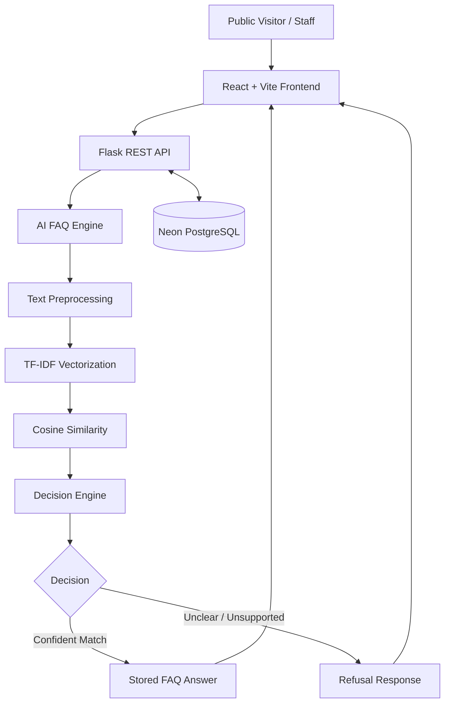

# ◈ Arc Lite — AI-Powered FAQ Assistant

**An intelligent FAQ assistant built to retrieve reliable answers from a knowledge base — and refuse when it doesn't have enough confidence.**

<p align="center">
  <a href="https://arc-lite-umber.vercel.app/">Live Demo</a> ·
  <a href="https://arc-lite.onrender.com/api/health">API Health</a> ·
  <a href="https://github.com/Priyanshu-pandey1/Arc-Lite">Source Code</a>
</p>

---

## Overview

Arc Lite is a full-stack FAQ assistant that helps users find information through natural-language questions.

It uses a custom NLP-based retrieval engine to identify relevant FAQs instead of relying on simple keyword matching or generating unsupported answers.

Its core principle is simple:

**Answer when confidence is sufficient. Refuse when it isn't.**

The application provides two interfaces:

- **Public Chat:** Visitors can ask questions without creating an account, receive FAQ answers, and submit feedback.
- **Staff Dashboard:** Authorized staff can manage FAQs, monitor conversations, review analytics, and maintain the knowledge base.

Built with React, Flask, Scikit-learn, and PostgreSQL, Arc Lite combines an interactive user experience with a confidence-based FAQ retrieval system.

> **Knowledge-base note:** The current FAQ entries are demonstration/sample content, not an official ArchintX knowledge base.

## Live Application

| Service | URL |
|---|---|
| Public Application | [arc-lite-umber.vercel.app](https://arc-lite-umber.vercel.app/) |
| Backend API | [arc-lite.onrender.com](https://arc-lite.onrender.com) |
| API Health Check | [Check API Status](https://arc-lite.onrender.com/api/health) |
| GitHub Repository | [Priyanshu-pandey1/Arc-Lite](https://github.com/Priyanshu-pandey1/Arc-Lite) |

## Key Features

### Public Chatbot
- No-login FAQ chat interface.
- Natural-language question handling.
- Retrieval of relevant answers from the knowledge base.
- Confidence-based refusal for unsupported questions.
- Thumbs-up and thumbs-down feedback.

### Anonymous Visitor History
- Separate chat histories for different browser visitors.
- Persistent conversation history.
- Rename, pin, and delete conversations.
- Visitor-level history isolation.

### Staff Authentication
- Dedicated staff login.
- JWT-based authentication.
- Password hashing.
- Protected dashboard routes.

### FAQ Management
- Create and manage FAQ entries.
- Organize FAQs into four categories:
  - Courses
  - Certificates
  - Jobs
  - Account
- Manage FAQ status and verification information.

### Analytics Dashboard
- Monitor chatbot activity.
- Review conversation statistics.
- Analyze FAQ categories and performance.
- View feedback and recent conversations.

### Conversation Management
- Persistent conversation records.
- Staff access to conversation history.
- Conversation-level feedback and management.

## AI Engine

The core of Arc Lite is a custom FAQ retrieval and decision-making engine built using traditional NLP and machine-learning techniques.

Rather than generating new answers, the engine identifies the most relevant FAQ and retrieves its stored answer.

### Retrieval Pipeline

1. **Text Preprocessing** — Processes and normalizes incoming questions.
2. **TF-IDF Vectorization** — Converts FAQ questions and user queries into numerical representations.
3. **Cosine Similarity** — Measures similarity between the incoming query and stored FAQ questions.
4. **Phrase Matching** — Provides additional matching evidence.
5. **Decision Engine** — Evaluates confidence, FAQ verification status, question relevance, and other conditions.
6. **Response Builder** — Returns the stored FAQ answer or an appropriate refusal response.

### Core Techniques

| Technique | Purpose |
|---|---|
| TF-IDF | Numerical representation of text |
| Word N-grams (1, 2) | Captures words and word combinations |
| Character N-grams (2, 5) | Helps match spelling and text variations |
| Cosine Similarity | Measures query-to-FAQ similarity |
| Phrase Matching | Provides additional matching evidence |
| Decision Engine | Determines whether a response is sufficiently reliable |

### Confidence-Based Decisions

| Similarity Score | Decision |
|---|---|
| ≥ 0.50 | Answer |
| ≥ 0.25 and < 0.50 | Unclear |
| < 0.25 | Refuse |

Additional checks handle inactive FAQs, unverified entries, generic questions, and out-of-scope queries.

**Design principle:** Arc Lite retrieves approved stored FAQ answers rather than generating responses using an LLM. Its refusal mechanism is designed to reduce unsupported answers and guessing.

## System Architecture



### Architecture Components

| Component | Responsibility |
|---|---|
| Frontend | Chat interface, staff login, FAQ management, and analytics |
| Backend | REST APIs, authentication, business logic, and database operations |
| AI Engine | FAQ retrieval, similarity scoring, and response decisions |
| Database | FAQs, staff records, conversations, visitor history, and feedback |

## Technology Stack

| Layer | Technologies |
|---|---|
| Frontend | React 19, Vite |
| Backend | Python, Flask 3 |
| API | REST API |
| AI / NLP | Scikit-learn, TF-IDF, Cosine Similarity |
| Data Processing | NumPy |
| Database | PostgreSQL |
| Database Hosting | Neon |
| Authentication | JWT, Password Hashing |
| Frontend Deployment | Vercel |
| Backend Deployment | Render |
| Version Control | Git, GitHub |

## Database

Arc Lite uses PostgreSQL hosted on Neon for persistent data storage.

The database supports:

- FAQ knowledge-base records.
- Staff authentication.
- Conversation records.
- Anonymous visitor sessions and chat history.
- User feedback.
- Analytics-related information.

## Testing & Quality Assurance

Testing was performed across the AI engine, backend APIs, and frontend application.

| Area | Testing Coverage |
|---|---|
| AI Engine | Matching, confidence decisions, refusal behaviour, and robustness |
| Backend APIs | FAQ operations, conversations, visitor history, analytics, and authentication |
| Regression | Existing functionality after code changes |
| Frontend | Linting and production build |
| Browser Testing | Manual functional verification |
| Visitor Isolation | Separate chat histories across visitors |

### Testing Summary

- Approximately **230 scripted checks** across backend API and AI-engine scripts.
- Dedicated AI evaluation and mixed-question testing.
- Frontend lint checks using Oxlint.
- Production build verification.
- Manual browser testing of public and staff workflows.
- Verification of visitor-history isolation and conversation management.

**Testing transparency:** The scripted checks primarily use standalone Python scripts rather than a unified pytest suite. Browser testing was manual, not automated using Playwright or Cypress. A CI pipeline is not currently included.

## Local Installation

### Prerequisites

- Python 3.10 or later
- Node.js and npm
- Git
- PostgreSQL database

### 1. Clone the Repository

```bash
git clone https://github.com/Priyanshu-pandey1/Arc-Lite.git
cd Arc-Lite
```

### 2. Backend Setup

```powershell
cd backend

python -m venv venv
.\venv\Scripts\Activate.ps1

pip install -r requirements.txt
```

Create a `.env` file inside the backend directory:

```env
DATABASE_URL=your_postgresql_connection_string
JWT_SECRET=your_secure_secret_key
CORS_ORIGINS=http://localhost:5173
```

Start the Flask backend using the configured application entry point.

### 3. Frontend Setup

Open another terminal:

```powershell
cd frontend

npm install
```

Create a `.env` file inside the frontend directory:

```env
VITE_API_BASE_URL=http://localhost:5000/api
```

Start the development server:

```bash
npm run dev
```

Vite will display the local frontend URL in the terminal.

**Security:** Use your own database credentials and a secure JWT secret. Never commit `.env` files, passwords, or secret keys to GitHub.

For detailed setup and deployment instructions, refer to the [Deployment Guide](references/project_documentation/11_Deployment_Guide.md).

## Deployment

Arc Lite is deployed using three services:

| Component | Platform |
|---|---|
| Frontend | Vercel |
| Backend | Render |
| Database | Neon PostgreSQL |

- React frontend deployed on Vercel.
- Flask backend hosted on Render using Gunicorn.
- Neon PostgreSQL provides persistent database storage.
- Environment variables configure database access, authentication, and frontend-backend communication.

## Project Structure

```text
Arc-Lite/
│
├── backend/
│   ├── ai_engine/
│   │   ├── decision_engine.py
│   │   ├── engine.py
│   │   ├── matcher.py
│   │   ├── preprocessing.py
│   │   ├── response_builder.py
│   │   └── vectorizer.py
│   ├── data/
│   ├── tests/
│   ├── app.py
│   └── requirements.txt
│
├── frontend/
│   ├── public/
│   ├── src/
│   │   ├── components/
│   │   ├── pages/
│   │   ├── services/
│   │   └── ...
│   ├── package.json
│   └── vite.config.js
│
├── references/
│   └── project_documentation/
│       ├── 01_Project_Overview.md
│       ├── 02_Complete_File_Structure.md
│       ├── 03_System_Architecture.md
│       ├── 04_Frontend_Deep_Dive.md
│       ├── 05_Backend_Deep_Dive.md
│       ├── 06_AI_Engine_Deep_Dive.md
│       ├── 07_Database_Documentation.md
│       ├── 08_API_Reference.md
│       ├── 09_User_Flows.md
│       ├── 10_Testing_and_QA.md
│       ├── 11_Deployment_Guide.md
│       ├── 12_Interview_Questions_and_Answers.md
│       ├── 13_Project_Presentation_Script.md
│       └── 14_Technical_Glossary.md
│
└── README.md
```

*This is a simplified representation of the main project structure.*

## Technical Documentation

The repository includes 14 detailed documents covering the implementation and architecture of Arc Lite.

| # | Documentation |
|---|---|
| 01 | [Project Overview](references/project_documentation/01_Project_Overview.md) |
| 02 | [Complete File Structure](references/project_documentation/02_Complete_File_Structure.md) |
| 03 | [System Architecture](references/project_documentation/03_System_Architecture.md) |
| 04 | [Frontend Deep Dive](references/project_documentation/04_Frontend_Deep_Dive.md) |
| 05 | [Backend Deep Dive](references/project_documentation/05_Backend_Deep_Dive.md) |
| 06 | [AI Engine Deep Dive](references/project_documentation/06_AI_Engine_Deep_Dive.md) |
| 07 | [Database Documentation](references/project_documentation/07_Database_Documentation.md) |
| 08 | [API Reference](references/project_documentation/08_API_Reference.md) |
| 09 | [User Flows](references/project_documentation/09_User_Flows.md) |
| 10 | [Testing & QA](references/project_documentation/10_Testing_and_QA.md) |
| 11 | [Deployment Guide](references/project_documentation/11_Deployment_Guide.md) |
| 12 | [Interview Questions & Answers](references/project_documentation/12_Interview_Questions_and_Answers.md) |
| 13 | [Project Presentation Script](references/project_documentation/13_Project_Presentation_Script.md) |
| 14 | [Technical Glossary](references/project_documentation/14_Technical_Glossary.md) |

## Future Improvements

- Automated browser-based testing.
- Continuous integration and deployment workflows.
- Improved FAQ ranking and retrieval evaluation.
- Multilingual FAQ support.
- Advanced semantic retrieval techniques.
- Expanded analytics and reporting capabilities.

## Author

**Priyanshu Pandey**

B.Tech — Computer Science and Engineering  
Specialization: Artificial Intelligence and Machine Learning

- **GitHub:** [Priyanshu-pandey1](https://github.com/Priyanshu-pandey1)
- **LinkedIn:** [Connect with me](https://www.linkedin.com/in/priyanshu-pandey-data/)

---

<p align="center">
  <strong>◈ Arc Lite</strong><br/>
  <sub>Answer confidently. Never guess.</sub>
</p>
